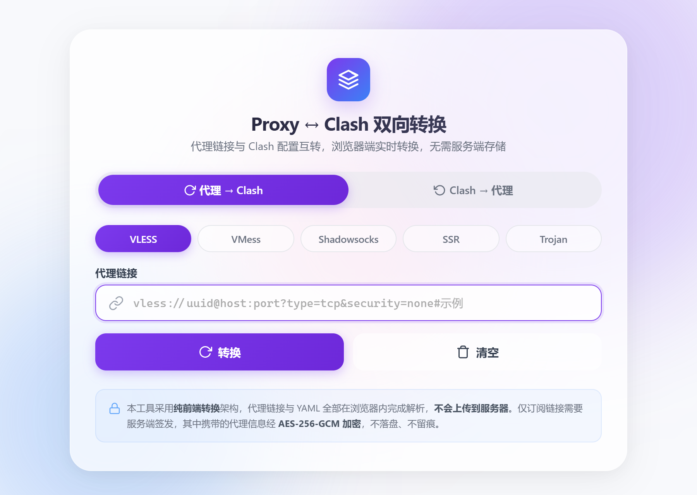
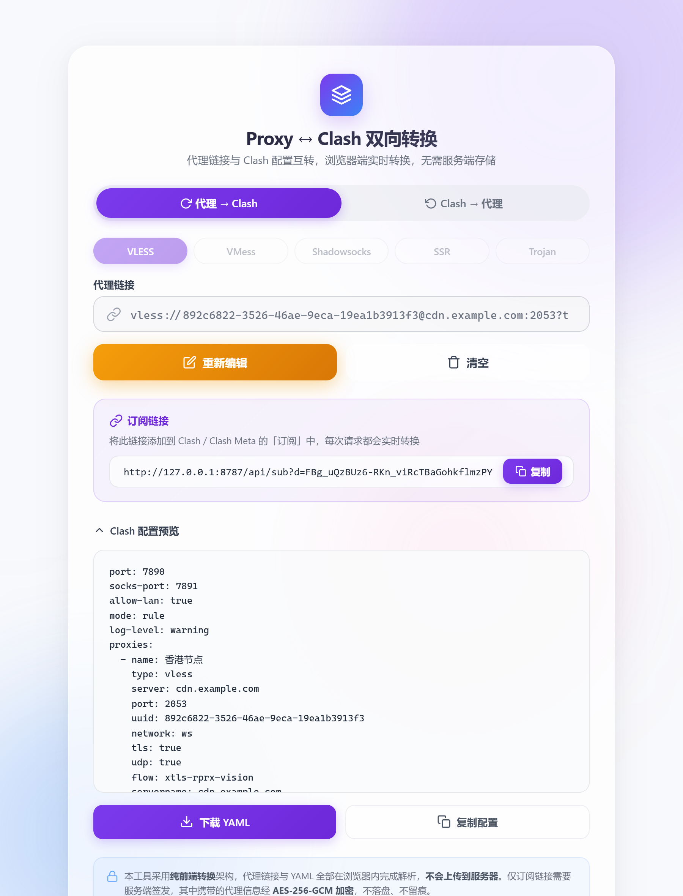
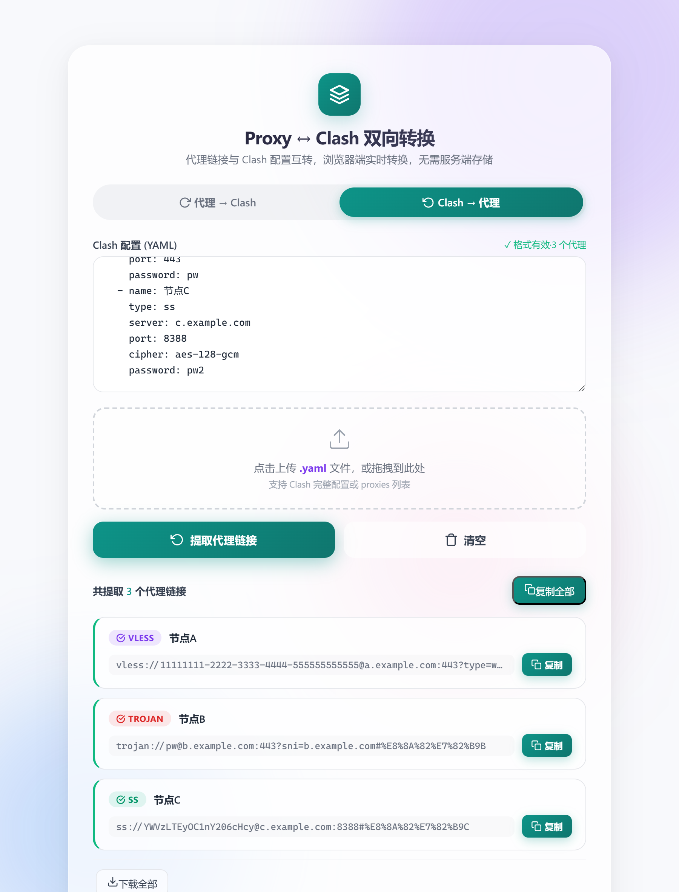

# Proxy ↔ Clash 双向转换器（Vite + React）

代理链接 ⇄ Clash 配置 实时互转 · 浏览器端转换 · 无状态服务端 · AES-256-GCM 加密订阅

https://github.com/worenbudaoni/clash-converter
> 本项目由原 Flask 单文件应用（[`clash-converter`](../clash-converter)）重写而来：
> 前端改为 **Vite + React 19 + TypeScript**，转换逻辑从 Python 迁移到 TypeScript，
> 并抽成前后端共享模块（`shared/`），浏览器内即可完成全部解析与生成。

---

## 界面预览

| 首页 | 代理 → Clash | Clash → 代理 |
|------|--------------|--------------|
|  |  |  |

---

## 目录

- [界面预览](#界面预览)
- [架构变化](#架构变化)
- [功能特性](#功能特性)
- [支持协议](#支持协议)
- [项目结构](#项目结构)
- [快速开始](#快速开始)
- [环境变量](#环境变量)
- [API 文档](#api-文档)
- [加密与兼容性](#加密与兼容性)
- [自测](#自测)
- [免责声明](#免责声明)
- [许可证](#许可证)

---

## 架构变化

原版是「Flask 渲染单页 + 服务端转换」；重写后是「Vite SPA + 极薄 API 服务」。

| 维度 | 原 Flask 版 | 本版（Vite + React） |
|------|-------------|----------------------|
| 页面 | `templates/index.html` 单文件（HTML + CSS + 原生 JS） | React 组件树 + 分层 CSS（`src/styles/*.css`） |
| 转换执行位置 | 服务端（`POST /api/convert`、`/api/to-url`） | **浏览器本地**（零请求，毫秒级） |
| 转换逻辑 | `app.py` 中的 `parse_*` / `proxy_to_*` | `shared/parsers.ts`、`shared/builders.ts`（TS） |
| YAML | PyYAML | js-yaml（前后端同构） |
| 服务端职责 | 转换 + 订阅 + 加密 | 仅订阅端点与订阅 token 签发 |
| 订阅加密 | `cryptography`（AES-256-GCM） | `node:crypto`（同算法、同二进制布局，**互相兼容**） |
| 状态管理 | 全局变量 + DOM 操作 | React hooks（`useState` / `useEffect` / Context） |

> 服务端仍然保留 `/api/convert` 与 `/api/to-url`，请求/响应结构与原版一致，方便已有脚本直接复用。

---

## 功能特性

| 特性 | 说明 |
|------|------|
| **双向转换** | 代理链接 → Clash 配置 / Clash 配置 → 代理链接 |
| **多协议支持** | VLESS、VMess、Shadowsocks、SSR、Trojan 全覆盖 |
| **浏览器端转换** | 解析与生成全部在本地完成，不依赖后端可用性 |
| **加密订阅链接** | 代理信息经 AES-256-GCM 加密后生成订阅 URL，UUID/密码不在链接中明文传输 |
| **订阅兼容** | 返回标准 proxies-only 格式 + `Subscription-Userinfo` 头，不覆盖本地 port/mode/rules |
| **YAML 实时校验** | 输入防抖 400ms 校验，提示格式错误与节点数量 |
| **拖拽上传** | 支持 `.yaml` / `.yml` / `.txt`，上传后自动提取 |
| **配置预览** | 转换后直接展开 YAML，可复制 / 下载 |
| **批量导出** | 一键复制全部链接或下载 `proxies.txt` |
| **双色调主题** | 两种模式分别使用紫色 / 青绿配色，背景光斑同步变色 |
| **玻璃态 UI** | 磨砂玻璃 + 漂浮光斑，桌面与移动端自适应 |
| **无状态** | 服务端不存储任何数据，订阅链接每次请求即时解密转换 |

---

## 支持协议

| 协议 | 格式 | 支持参数 |
|------|------|----------|
| **VLESS** | `vless://uuid@host:port?params` | tcp/ws/grpc/h2、TLS、Reality、flow、sni、fp、pbk、sid、spx |
| **VMess** | `vmess://base64(json)` / `vmess://uuid@host:port` | alterId、tcp/ws/grpc/h2、TLS、sni、alpn、host、path |
| **Shadowsocks** | `ss://base64(method:pw)@host:port` | SIP002 / 传统格式、plugin |
| **SSR** | `ssr://base64(...)` | protocol、obfs、obfsparam、protoparam |
| **Trojan** | `trojan://pw@host:port?params` | sni、alpn、flow、skip-cert-verify |

---

## 项目结构

```
clash-converter-vite/
├── index.html                  # Vite 入口
├── vite.config.ts              # 开发代理：/api → 127.0.0.1:8787
├── tsconfig.json               # 单一 TS 配置（前端 + 服务端 + 共享）
├── Dockerfile / docker-compose.yml
├── start.bat                   # Windows 一键启动（安装 → 构建 → 启动）
│
├── shared/                     # ★ 前后端共享的转换核心（纯 TS，无 DOM/Node 依赖）
│   ├── index.ts                # 门面：convertUrlToClash / convertYamlToProxyUrls / ...
│   ├── parsers.ts              # 链接 → 节点对象（对应原 parse_*）
│   ├── builders.ts             # 节点对象 → 链接（对应原 proxy_to_*）
│   ├── clash.ts                # Clash 配置构建 + YAML 序列化/解析
│   ├── base64.ts               # Base64 / URL-safe Base64（含 UTF-8 处理）
│   ├── url.ts                  # 查询串 / fragment 解析
│   └── types.ts                # 共享类型
│
├── server/                     # 极薄 API 服务（Express 5）
│   ├── index.ts                # /api/sub、/api/sub-token、兼容接口、静态托管
│   └── crypto.ts               # AES-256-GCM 加解密
│
├── src/                        # React 前端
│   ├── main.tsx                # 入口 + 样式装载
│   ├── App.tsx                 # 布局 / 模式切换 / 主题
│   ├── components/
│   │   ├── ProxyToClash.tsx    # 面板一：代理 → Clash
│   │   ├── ClashToProxy.tsx    # 面板二：Clash → 代理
│   │   ├── ModeToggle.tsx      # 模式开关
│   │   ├── Header.tsx / Background.tsx / PrivacyNotice.tsx
│   │   └── icons.tsx           # 内联 SVG 图标
│   ├── hooks/
│   │   ├── ToastProvider.tsx   # 顶部 Toast 状态机
│   │   └── toastContext.ts     # Context + useToast
│   ├── lib/                    # api / clipboard / download / validate / constants
│   └── styles/                 # base / controls / output / toast
│
└── scripts/
    ├── selftest.ts             # 转换核心自测（41 项）
    └── interop_check.py        # 与 Python 版加密互通验证
```

---

## 快速开始

### 方式一：开发模式（热更新）

```bash
npm install
npm run dev
```

- 前端（Vite HMR）：http://127.0.0.1:5173
- API 服务：http://127.0.0.1:8787
- 开发时 `/api/*` 由 Vite 代理到 8787，因此订阅链接同样是 `http://127.0.0.1:5173/api/sub?d=...`

> 只跑前端也可以（`npm run dev:web`）：转换功能完全可用，仅订阅链接会提示后端不可用。

### 方式二：生产模式（单端口）

```bash
npm install
npm run build      # tsc 类型检查 + vite build → dist/
npm start          # Express 同时托管 dist 与 /api
```

访问 http://127.0.0.1:8787

### 方式三：Docker

```bash
docker compose up -d
# 指定端口
PORT=8080 docker compose up -d
# 查看日志 / 停止
docker compose logs -f
docker compose down
```

### 方式四：Windows 一键启动

双击 `start.bat`：自动检查 Node.js → 安装依赖 → 构建前端 → 启动服务。

### 反向代理（Caddy 示例）

```
your-domain.com {
    reverse_proxy 127.0.0.1:8787
}
```

服务端会读取 `X-Forwarded-Proto` / `X-Forwarded-Host`，正确生成 `https://` 开头的订阅链接。

---

## 环境变量

| 变量 | 默认值 | 说明 |
|------|--------|------|
| `PORT` | `8787` | API / 静态服务端口 |
| `ENCRYPTION_KEY` | 随机临时密钥 | 订阅链接加密密钥，任意字符串，经 SHA-256 派生为 32 字节 AES 密钥 |

> 未设置 `ENCRYPTION_KEY` 时，每次启动生成临时密钥，重启后旧订阅链接失效。
> 设置后与**原 Python 版**保持同一密钥即可无缝迁移（见下节）。

---

## API 文档

### `POST /api/sub-token`

只签发加密 token（前端已完成本地转换时使用）。

```json
// 请求
{ "url": "vless://uuid@host:port?type=ws&security=tls#remark" }
// 响应
{ "token": "oZTUxV7N8...", "sub_url": "https://your-domain.com/api/sub?d=oZTUxV7N8..." }
```

### `GET /api/sub?d=<encrypted>`

订阅端点，添加到 Clash / Clash Meta 的订阅管理中即可。

- 参数：`d`（加密 token，推荐）、`url`（明文，兼容旧链接）
- 响应：`Content-Type: text/plain; charset=utf-8`
- 响应头：`Subscription-Userinfo: upload=0; download=0; total=0; expire=0`

### `POST /api/convert`

与原版接口一致：代理链接 → 完整 Clash 配置。

```json
// 响应
{
  "protocol": "vless",
  "yaml": "port: 7890\n...",
  "filename": "clash_香港节点.yaml",
  "sub_url": "https://your-domain.com/api/sub?d=..."
}
```

### `POST /api/to-url`

与原版接口一致：Clash YAML → 代理链接列表。

```json
// 响应
{
  "proxies": [{ "name": "节点A", "type": "vless", "url": "vless://..." }],
  "total": 1
}
```

### `GET /api/health`

```json
{ "ok": true, "service": "clash-converter", "version": "2.0.0" }
```

---

## 加密与兼容性

订阅链接中的代理链接使用 **AES-256-GCM** 加密：

| 项目 | 说明 |
|------|------|
| 算法 | AES-256-GCM（认证加密） |
| 密钥派生 | `SHA-256(ENCRYPTION_KEY)` → 32 字节 |
| 二进制布局 | `[12B nonce][16B tag][ciphertext]` → URL-safe Base64（无 padding） |
| 兼容性 | 与原 Python 版布局完全一致：**两边用同一 `ENCRYPTION_KEY` 时订阅链接可互相解密** |

已验证（`scripts/interop_check.py`）：

- Node 生成的 token → Python 版 `decrypt_url()` 正确解出原始链接；
- Python 版 `encrypt_url()` 生成的 token → Node 版 `/api/sub` 正确返回 YAML。

因此从 Flask 版迁移时，只要沿用原来的 `ENCRYPTION_KEY`，已经分发出去的订阅链接不会失效。

---

## 自测

```bash
npm run test:core   # 41 项断言：五协议双向转换、订阅格式、错误处理
npm run lint        # oxlint
npm run build       # tsc --noEmit + vite build
```

---

## 免责声明

> 1. **合法使用**：本工具仅供学习和研究使用，用户应遵守所在国家或地区的法律法规。禁止用于任何非法用途。
> 2. **数据流向**：转换完全在浏览器本地完成，代理链接与 YAML 不会上传；仅订阅链接需要服务端签发，其中原始链接以加密参数形式存在，服务端每次请求即时解密转换，不落盘、不留痕。
> 3. **加密说明**：AES-256-GCM 仅用于防止链接在传输或分享过程中被明文截获，不构成对代理服务的任何法律保护或匿名保证。
> 4. **服务状态**：本工具按「原样」提供，不提供任何明示或暗示的保证。
> 5. **外部链接**：生成的订阅链接仅供个人在自有客户端使用，请勿分享给不可信第三方。

---

## 许可证

基于 [MIT License](./LICENSE) 开源。
